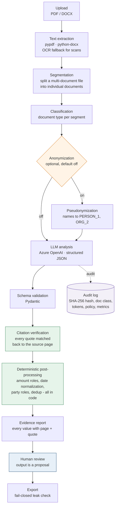

# Evidence-First Document Analysis Pipeline

A document analysis pipeline built around one rule:

> **The model extracts. Code computes. A human decides.**

An LLM is good at finding *where* something is written in a 40-page contract. It is
unreliable at staying consistent, at classifying what it found, and at knowing when it is
wrong. So in this pipeline the model is never the last word: every value it returns is
checked against the source text before it reaches the screen, anything a rule can decide
is decided by code rather than by the model, and the output is presented as a proposal for
review — never as a decision.

Built for document workflows in regulated professions (law firms, tax advisors, property
management) where an unsourced claim is worse than no answer at all.


*Analysing a synthetic German lease in demo mode — no credentials, no real document.*

*The percentages are measured, not decorative. **"Claims with verified source: 73%"** is
the point of the project, not a defect: the system checked every claim the model made,
traced 73% of them back to a verbatim quote in the source, and says so instead of
presenting all of them as equally sound. The alternative — the default for most LLM
summarizers — is 100% confident output with no way to tell which quarter is unfounded.*

---

## The problem this solves

Ask a language model to summarize a contract and you get a fluent answer with no way to
check it. For a professional who is liable for the result, that is unusable. The failure
modes are specific:

| Failure | What this pipeline does about it |
|---|---|
| Model invents a fact that is not in the document | Every claim carries a page number and a verbatim quote; quotes are matched back against the source text and the match rate is displayed |
| Model mislabels which figure is which | Amount-to-role mapping (deposit vs. rent vs. utilities) is decided in Python from keyword context with a confidence score, not left to the model |
| Model quietly rewords what the document says | Restatement fields are protected from the tone filter, so a quoted "muss" is never softened into something the document does not say |
| Model outputs legal conclusions | Assessment output is constrained to non-advisory phrasing ("noted", "unclear", "to be verified") |
| Confidential text leaks into logs or exports | Uploads stay in memory; the audit log records hashes and metrics, not document text. Export is fail-closed when anonymization is on |

---

## Architecture



The two green stages are where the design lives. Everything before them is ordinary
document plumbing; everything after them is presentation. **Citation verification** and
**deterministic post-processing** are what turn a plausible-sounding summary into
something a professional can check.

Concretely, post-processing means the model is not the authority on anything a rule can
decide: which amount is the deposit and which is the monthly rent is resolved from keyword
context with a confidence score (`core/labels.py`), dates are normalized to ISO and sorted
into categories such as start-of-term vs. notice deadline (`core/legacy_deadlines.py`),
party roles are mapped from the document's own role labels (`core/party_extractor.py`),
and near-duplicate entries are merged. The model's job is to point at the right place in
the document; the classification is code.

---

## How citation verification works

The model is asked to return, for every claim, the page number and a verbatim snippet
from the source. Those snippets are then verified against the actual extracted page text —
they are not taken on trust.

Matching is deliberately not exact-substring. Extracted PDF text has broken line breaks,
hyphenation, and inconsistent whitespace, so a literal comparison would reject correct
quotes. Instead the text is normalized and compared with a sliding window using
`rapidfuzz.partial_ratio`, with a uniqueness margin so that a quote matching many places
equally well is not silently attributed to the first one.

Two numbers are surfaced in the UI:

- **Quotes located in source** — was the quoted snippet actually found on the cited page?
- **Claims with verified source** — how many claims carry a citation that checked out?

A claim whose citation fails verification is marked, not hidden. The point is not to
reach 100 % — it is to make the failures visible instead of letting them pass as fact.

---

## Restatement vs. assessment: the seam that matters

The output has a non-advisory tone filter — it rewrites phrasings that would read as
legal advice into neutral, checkable language.

Applying that filter everywhere turned out to be a bug, and a subtle one. When the
document itself says *"die Kündigungserklärung **muss** dem Vermieter zugehen"*, the
filter rewrote the restatement to *"…**zu prüfen** dem Vermieter zugehen"* — while the
quote displayed directly underneath still read *"muss"*. The interface was contradicting
its own evidence, and softening what the document actually said.

So output fields are split into two classes:

- **Restatement fields** (`key_facts`, `deadlines`, `parties`, `amounts`, …) — the model
  is reporting what the document says. Only a minimal always-on rule set applies. Ordinary
  German words that happen to appear in legal prose (`muss`, `wirksam`, `zulässig`) are
  left alone, because rewriting them falsifies the document.
- **Assessment fields** (`issues`, `uncertainties`, `open questions`, …) — the model is
  offering its own judgement. Here the full filter applies.

Unknown or unlisted fields default to the conservative side. The rule: *never let a
display filter change what the source is reported to have said.*

---

## Data protection posture

The pipeline was designed for documents covered by professional confidentiality
obligations, which shaped several decisions:

- **No document persistence by default.** Uploaded files are processed in memory and never
  written to disk. The audit log stores a SHA-256 hash of the document, its class, token
  counts, the active policy, and citation metrics — not the text and not the filename.
  The one component that *can* put analysis output on disk is the optional result cache
  (`DOCPIPE_DOC_CACHE_ENABLED`, **off by default**); enabling it is a deliberate trade of
  confidentiality for speed.
- **Configurable region.** The Azure OpenAI endpoint comes from `.env`; an EU-region
  deployment is a configuration choice, not something the code can enforce on your behalf.
- **Optional pseudonymization, default off.** Names, addresses, IBANs, case references and
  similar are replaceable with placeholder tokens (`[PERSON_1]`, `[ORG_2]`) *before* the
  text leaves the machine. It defaults to off because redaction measurably degrades
  extraction quality, and the intended deployment covers confidentiality through the
  processor agreement instead. It is a toggle, not a default guarantee.
- **Fail-closed export.** When anonymization was active for a run, the export is scanned
  for content that should have been masked before it is produced. On a hit the export is
  refused outright rather than shipped with a gap. (With anonymization off, real names in
  the export are expected rather than a leak, so the guard correctly stands down.)
- **No plaintext logging.** Log statements carry identifiers and error types, not document
  content.

**This is a technical posture, not a compliance certification.** Nothing here constitutes
legal advice, and running this code does not by itself make a deployment GDPR-compliant
or compliant with any professional-secrecy statute.

---

## Try it without credentials

The repo ships with a demo mode and three synthetic sample documents, so the full pipeline
runs end to end with no Azure account:

```bash
pip install -r requirements.txt
DOCPIPE_DEMO_MODE=1 streamlit run app.py
```

Then upload one of the files from `samples/`.

In demo mode every Azure call is replaced by a deterministic local stub
(`core/demo_stub.py`) that builds schema-valid analysis output from real sentences in the
uploaded document. Its one hard invariant: **every quote it emits is a verbatim substring
of the input**, so citation verification is exercised for real rather than faked. Demo mode
is labelled in the interface whenever it is active, and it is never entered automatically
just because credentials are missing — it has to be switched on deliberately.

### With Azure OpenAI

```bash
cp .env.example .env       # then fill in AZURE_OPENAI_* values
streamlit run app.py
```

All configuration is environment-driven and documented inline in `.env.example`.

### Tests

```bash
pip install -r requirements.txt -r requirements-dev.txt
python -m pytest tests/ -q
```

---

## Sample documents

`samples/` contains three synthetic German documents generated by
`scripts/generate_samples.py` — a residential lease, a payment reminder, and a statement of
claim. They contain invented names, addresses and amounts, and exist so the pipeline has
something realistic to chew on without any real document being involved.

---

## Repository layout

```
app.py                  Streamlit entry point
core/                   pipeline: extraction, segmentation, classification,
                        LLM client, citation verification, evidence assembly
  demo_stub.py          offline deterministic stand-in for the model
  citation.py           quote → source matching
  evidence_map.py       evidence assembly + tone filter
governance/             policy, audit log, redaction/pseudonymization
services/               orchestration between UI and pipeline
ui/                     Streamlit render layer
workflows/              document-type-specific analysis flows
samples/                synthetic sample documents
tests/                  unit + smoke tests (~1100 cases)
```

---

## Status and honest scope

This is an **MVP**, built solo and shown in a single demo in February 2026. It has no
users, was never deployed for a customer, and the business behind it was discontinued.
It is published as an engineering artifact.

What it demonstrates: structured LLM output with schema validation, verification of model
claims against source text, a redaction layer with fail-closed export, deterministic
post-processing where the model is unreliable, and an audit trail — with a test suite
covering the parts that are easy to break silently.

What it is not: a product, a service, or legal advice.

**Known limitations**

- Streamlit prototype — single-user, no auth, no tenancy.
- Tuned for German documents; document-type profiles are German-specific, though the
  pipeline itself is not.
- OCR quality for scanned documents depends entirely on Azure Document Intelligence.
- Segmentation of multi-document PDFs is heuristic and can misplace a boundary on unusual
  layouts.
- Demo-mode output is deliberately shallow: the stub selects real sentences from the
  document, so its "key statements" read as sentence fragments. It exists to exercise the
  pipeline, not to imitate a model's writing quality.

## License

MIT — see [LICENSE](LICENSE).
